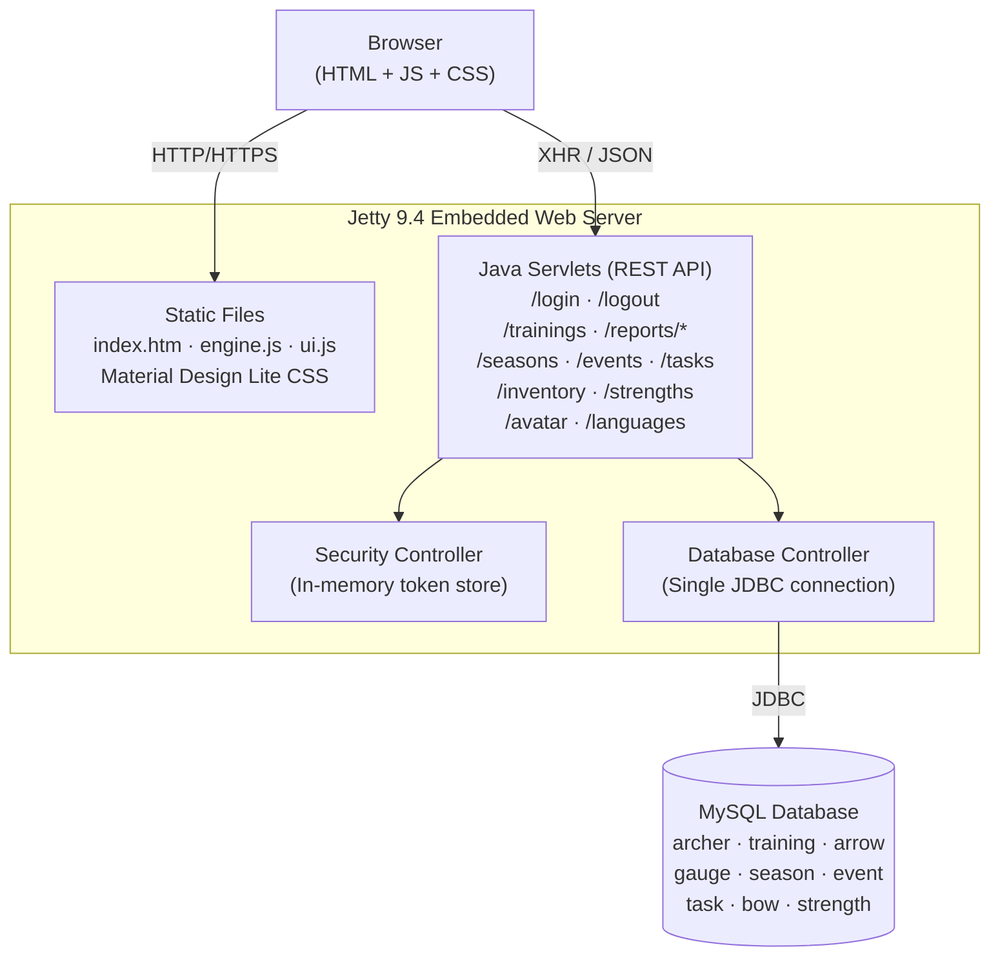

# AAA — Arkanos Advanced Archery

> ⚠️ **This repository is a prototype and is now archived.** Development has continued in the successor repositories [aaa-app](https://github.com/matheuscodes/aaa-app) and [aaa-api](https://github.com/matheuscodes/aaa-api). See [Evolution](#evolution) for details.

**AAA** is a personal web application for archers to record and analyse their training sessions. Users can log training data (distances, arrow counts, round types), manage seasons and events, track equipment (bows), monitor physical strength conditioning, and view monthly and homescreen reports with graphs.

The application supports English and German and was used personally by the author during its active development period (August–October 2015).

---

## Table of Contents

- [Features](#features)
- [Running Locally](#running-locally)
- [Architecture](#architecture)
- [Code Quality](#code-quality)
- [Evolution](#evolution)
- [Follow-up Repositories](#follow-up-repositories)
- [Timeline](#timeline)
- [License](#license)

---

## Features

- **Training log** – record training sessions and gauge sessions (scored rounds), including arrows per end, distance, target type, and round format
- **Season management** – group training sessions by archery seasons
- **Event tracking** – log competitions and other archery events
- **Inventory** – manage bows and equipment
- **Strength tracking** – record physical conditioning exercises
- **Reports** – monthly summary reports and a homescreen dashboard with SVG graphs
- **Multi-language** – English and German

---

## Running Locally

### Prerequisites

| Tool | Version |
|------|---------|
| Java | 7+ |
| Maven | 3.x |
| MySQL | 5.x / 8.x |

### 1. Set up the database

Start a local MySQL instance and create a database:

```sql
CREATE DATABASE aaa;
```

Populate the schema by running the SQL scripts for each entity (tables: `archer`, `training`, `arrow`, `gauge`, `season`, `event`, `task`, `bow`, `strength`). No migration tooling was added to the prototype — tables must be created manually to match the fields defined in the data classes under `src/main/java/org/arkanos/aaa/data/`.

### 2. Generate the SSL keystore (first-time only)

The embedded Jetty server requires an SSL certificate. Generate a self-signed one with:

```bash
mvn keytool:generateKeyPair
```

This creates `target/jetty-ssl.keystore` using the configuration in `pom.xml` (alias `aoskeys`, password `secret`).

### 3. Start the server

```bash
mvn jetty:run \
  -DMYSQL_HOST=localhost:3306 \
  -DMYSQL_DATABASE=aaa \
  -DMYSQL_USER=root \
  -Dmysql_password=<your_password>
```

The system properties `MYSQL_HOST`, `MYSQL_DATABASE`, and `MYSQL_USER` are read directly in `Database.java`; `mysql_password` is interpolated via Maven into the `MYSQL_PASSWORD` system property set in `pom.xml`.

The application starts on:

| Protocol | Port |
|----------|------|
| HTTP     | 80   |
| HTTPS    | 443  |

Open `http://localhost/` in your browser.

> **Note:** Ports 80 and 443 require elevated privileges on Linux/macOS. Either run as root (not recommended) or change the ports in `jetty-http.xml` and `jetty-https.xml`.

### 4. CloudControl / environment variables (alternative)

The database controller also reads CloudControl-style environment variables if present:

```
MYSQLS_DATABASE, MYSQLS_HOSTNAME, MYSQLS_PORT, MYSQLS_USERNAME, MYSQLS_PASSWORD
```

These take precedence over the system properties.

---

## Architecture

The prototype is a **monolithic Java web application**: a single Jetty server instance serves both the REST API (Java Servlets) and all static frontend assets.



### Backend packages

| Package | Responsibility |
|---------|---------------|
| `org.arkanos.aaa.api` | HTTP Servlet endpoints — one class per resource: `Login`, `Logout`, `Trainings`, `Reports`, `Seasons`, `Events`, `Tasks`, `Inventory`, `Strenghts`, `Avatar`, `Languages` |
| `org.arkanos.aaa.controllers` | Infrastructure — `Database` (JDBC), `Security` (token management), `HTTP` (response helpers), `Language`, `Log` |
| `org.arkanos.aaa.data` | Domain model — `Archer`, `Training`, `Season`, `Event`, `Task`, `Bow`, `Strength` |
| `org.arkanos.aaa.languages` | i18n strings — `English`, `German` (extend `Base`) |

### Frontend

The UI is a **single-page application** built entirely with plain JavaScript and jQuery, rendered dynamically into one HTML page (`index.htm`):

| File | Role |
|------|------|
| `engine.js` | All API calls (XHR), user state, local draft storage |
| `ui.js` | HTML generation, screen transitions (jQuery animations), SVG reports |
| `crypto-js-md5.js` | MD5 hashing of passwords client-side before transmission |
| `1.0.5.material.deep_purple-indigo.min.css` | Material Design Lite v1.0.5 (vendored) |

Third-party libraries are loaded from public CDNs at runtime: Google Fonts/Icons, Material Design Lite JS, jQuery 2.1.4, and jQuery UI 1.11.4.

### Authentication

Login sends `{email, hashed_password}` (MD5, client-side). The server validates against the database and returns a cookie containing a random token. Subsequent requests present that cookie; the `Security` controller validates it against an **in-memory `HashMap`** (tokens are lost on server restart and do not survive horizontal scaling).

---

## Code Quality

This is an acknowledged prototype. The following issues exist and were intended to be addressed in the successor projects:

- **No automated tests.** A JUnit 3.8.1 dependency is declared but no test classes were ever written.
- **No CI/CD pipeline.** There are no GitHub Actions or other workflows configured.
- **SQL injection risk.** `Database.sanitizeString()` performs only basic character substitution. The code contains TODO comments acknowledging it should be replaced with prepared statements; `Database.prepare()` was added late but adoption is incomplete.
- **Weak password hashing.** Passwords are hashed with MD5 client-side and stored as MD5 in the database — not a suitable storage strategy.
- **In-memory session management.** Security tokens are stored in a `HashMap` with no persistence, no distributed support, and only a single active token per user.
- **Single database connection.** No connection pool; the application maintains one `static Connection` shared across all threads.
- **Hardcoded defaults.** `Database.java` contains default credentials (`root`/`1234`) and a hardcoded host (`localhost:3306/aos`).
- **Large, unmodularised JavaScript files.** `engine.js` and `ui.js` contain all frontend logic; there is no module system, no bundler, and no linting.
- **External CDN runtime dependencies.** Google APIs and jQuery are fetched from public CDNs at page load time — fragile for offline use or CDN changes.
- **Class name typo.** The strength endpoint class is named `Strenghts` (missing the second `t`).
- **Copied copyright headers.** Several files include a copyright header referencing "Arkanos Organizer Suite (AOS)", the predecessor project from which login code was imported.
- **TODO-heavy codebase.** Dozens of `// TODO` comments are scattered throughout, some noting missing features or deferred design decisions (e.g. `// TODO: This is a basic clean, needs improvement.`).

---

## Evolution

The prototype served its purpose as a rapid proof-of-concept. Starting in 2016, the application was rebuilt with a proper separation of concerns across two successor repositories.

### Comparison

| Aspect | `aaa` (prototype) | `aaa-app` + `aaa-api` (successor) |
|--------|-------------------|----------------------------------|
| **Architecture** | Monolithic — API and frontend in one Jetty WAR | Separate frontend (`aaa-app`) and backend (`aaa-api`) services |
| **Frontend technology** | Vanilla JS + jQuery + Material Design Lite (CDN) | React 19 + Material UI v9, bundled with Vite |
| **Build system** | Maven WAR packaging | Vite (frontend) |
| **State management** | Global `User` object, DOM mutation | React component state |
| **Internationalisation** | Java `Base`/`English`/`German` classes served via API | `i18next` with a dedicated `aaa-languages` package |
| **Charts** | Custom SVG rendering in `ui.js` | Chart.js via `react-chartjs-2` |
| **Testing** | None | Vitest + Testing Library; CodeClimate + SonarCloud |
| **CI/CD** | None | GitHub Actions; deployed to AWS S3 (frontend) |
| **Security** | In-memory tokens, MD5 passwords, basic sanitization | Managed by `aaa-api` (proper auth, separate concern) |
| **Code quality tooling** | None | ESLint, CodeClimate, SonarCloud |
| **Deployment** | Manual (`mvn jetty:run`) | Automated to `archery.app` |

The key architectural shift was **splitting the monolith**: the frontend became a standalone React SPA (`aaa-app`) deployed independently to a CDN, and the backend API became a dedicated service (`aaa-api`). This separation enabled independent deployments, cleaner codebases, and proper tooling for each layer.

---

## Follow-up Repositories

### [matheuscodes/aaa-app](https://github.com/matheuscodes/aaa-app)

The frontend successor to this prototype. A React single-page application that provides the full archery training UI — login, training input, season management, reporting dashboards, equipment settings, and more. Built with Vite, styled with Material UI, tested with Vitest, and deployed to [archery.app](https://archery.app). Actively maintained with Dependabot, ESLint, CodeClimate, and SonarCloud integrations.

### [matheuscodes/aaa-api](https://github.com/matheuscodes/aaa-api) *(private)*

The backend API successor. Provides the REST endpoints consumed by `aaa-app`, replacing the Java Servlet layer of this prototype. The separation of the API into its own repository allows independent versioning and deployment of the backend independently of the frontend.

---

## Timeline

| Date | Milestone |
|------|-----------|
| **August 2015** | First commit — project bootstrapped from an earlier personal archery tracking tool ("Trainingsbericht") |
| **Aug–Oct 2015** | Active feature development: training log, seasons, events, inventory, strength tracking, monthly reports, homescreen dashboard, avatars, multi-language support |
| **October 2015** | Last major functional commit; prototype considered feature-complete for personal use |
| **Mid 2016** | Frontend extracted into the new `aaa-app` repository (dedicated React application); `aaa-api` created as a separate backend service |
| **May 2020** | Dependabot security update — Jetty upgraded from 9.2.8 to 9.4.28 |
| **July 2020** | Dependabot security update — MySQL Connector/J upgraded from 5.1.6 to 8.0.16; last commit to this repository |
| **2026** | Repository archived — superseded by `aaa-app` and `aaa-api` |

---

## License

This project is licensed under the **GNU Affero General Public License v3.0**.  
See the [LICENSE](https://www.gnu.org/licenses/agpl-3.0.html) for details.

Copyright (C) 2015 Matheus Borges Teixeira
